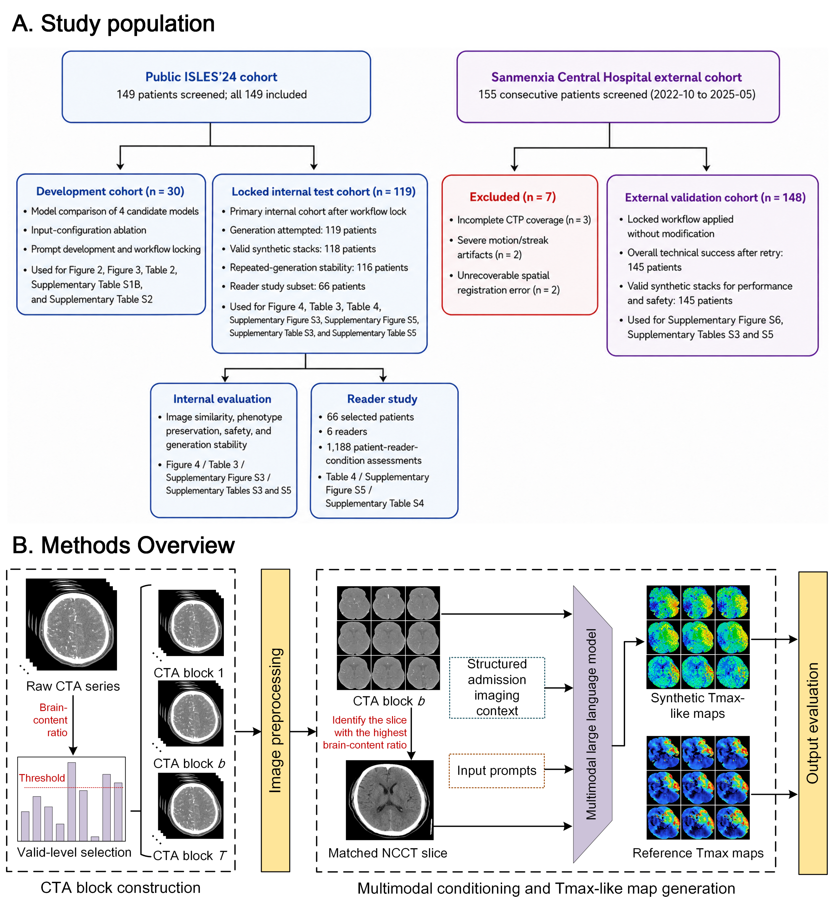

# Multisource Evidence-Guided Radiological Image Translation (MERIT)

MERIT is a training-free framework for generating synthetic Tmax-like perfusion maps from admission computed tomography angiography (CTA) and non-contrast computed tomography (NCCT). It combines a nine-slice CTA panel, a matched NCCT slice, and structured imaging descriptions with available clinical information as inputs to a multimodal generative model. The workflow covers image preprocessing, multimodal condition construction, map generation, and extraction of the central target slice for evaluation.

